# Implementation Plan: k3s Atomic Red Team Emulation Testing Suite

- **Target Plan**: `plans/261106-1439-k3s-atomic-emulation-testing/plan.md`
- **Branch**: `synkerns`
- **Cluster Target**: k3s v1.33.0+k3s1 (Ubuntu 24.04/22.04 nodes, Cilium CNI)
- **Status**: DRAFT / READY FOR REVIEW

---

## 1. Executive Summary & Objective

Build an automated, robust Bash-based testing framework (`scripts/k3s/`) that:
1. **Initializes & isolates the test environment** (`setup.sh`): Creates a dedicated test namespace (`atomic-test`) with required Pod Security Admission (`privileged`) labels and pre-stages test runner workloads.
2. **Executes atomic emulations individually or in batches** (`run_emulation.sh` / `run_all.sh`): Dispatches verified atomic emulation tests mapped to the MITRE ATT&CK techniques in `synkern-dataset-id.csv`.
3. **Logs execution telemetry for future eBPF tracing**: Outputs test start timestamp, target node, pod name, container ID, and process PID to facilitate subsequent `bpftrace` correlation.
4. **Guarantees clean teardown** (`teardown.sh`): Completely purges created namespaces, pods, jobs, and temporary filesystem artifacts, returning the k3s cluster to its exact pre-test state.

---

## 2. Emulation Scope & Categorization

From `synkern-dataset-id.csv`, tests are partitioned into three execution domains:

```mermaid
graph TD
    A[k3s Test Suite] --> B[Category A: Native K8s]
    A --> C[Category B: In-Pod Workload]
    A --> D[Category C: Node / Host Level]

    B --> B1[T1609: Container Admin Exec]
    B --> B2[T1611: nsenter Host Escape]
    B --> B3[T1053.007: CronJob Orchestration]
    B --> B4[T1105: Ingress Tool Transfer]
    B --> B5[T1136.001: Local Account Creation]
    B --> B6[T1053.002: At Job]

    C --> C1[T1070.003: Clear History]
    C --> C2[T1070.004: File Deletion]
    C --> C3[T1070.006: Timestomp]
    C --> C4[T1070.008: Mailbox Data]
    C --> C5[T1059.004: Unix Shell Execution]
    C --> C6[T1055.009: Proc Memory Injection]
    C --> C7[T1548.001: SUID Abuse]
    C --> C8[T1003.008: /etc/shadow Access]
    C --> C9[T1053.003: Cron Persistence]
    C --> C10[T1046: Network Service Discovery]
    C --> C11[T1036.003: Masquerading]

    D --> D1[T1543.002: Systemd Service]
    D --> D2[T1014: Rootkit LKM - Optional/Guarded]
```



---

## 3. Architecture & File Layout

Proposed directory structure under `scripts/k3s/`:

```
scripts/k3s/
├── config.env                 # Global parameters (NAMESPACE, TIMEOUT, RUNNER_IMAGE)
├── common.sh                  # Reusable logging, assertion, and kubectl helpers
├── setup.sh                   # Environment setup (namespace, PSA labels, runner pod)
├── teardown.sh                # Complete cluster teardown & verification
├── run_emulation.sh           # Dispatcher for a single emulation technique
├── run_all.sh                 # Master test harness with summary reporting
└── emulations/
    ├── native-k8s/
    │   ├── T1609.sh           # kubectl exec into pod
    │   ├── T1611.sh           # nsenter host escape pod
    │   ├── T1053.007.sh       # CronJob creation (patched for batch/v1)
    │   ├── T1105.sh           # Ephemeral curl egress pod
    │   ├── T1136.001.sh       # User creation in pod
    │   └── T1053.002.sh       # At job pod
    ├── in-pod/
    │   ├── T1070.003.sh       # Clear bash history inside runner
    │   ├── T1070.004.sh       # File deletion / shred inside runner
    │   ├── T1070.006.sh       # Timestomping via touch inside runner
    │   ├── T1070.008.sh       # Mailbox data manipulation
    │   ├── T1059.004.sh       # Pipe-to-shell & living-off-the-land shell
    │   ├── T1055.009.sh       # Proc memory overwrite
    │   ├── T1548.001.sh       # SUID binary creation (chmod u+s)
    │   ├── T1003.008.sh       # Reading /etc/shadow
    │   ├── T1053.003.sh       # Cron job manipulation
    │   ├── T1046.sh           # Pod-level port scanning
    │   └── T1036.003.sh       # Masquerading cp /bin/sh /tmp/crond
    └── node/
        └── T1543.002.sh       # Systemd service creation on host node
```

---

## 4. Component Design Specifications

### 4.1. `config.env`
Configuration file holding user-overridable environment variables:
- `TARGET_NAMESPACE="atomic-test"`
- `RUNNER_POD_NAME="atomic-runner"`
- `RUNNER_IMAGE="ubuntu:22.04"`
- `KUBECTL_TIMEOUT="60s"`
- `LOG_DIR="logs/k3s-emulation"`

### 4.2. `common.sh`
Shared utility functions imported by all scripts:
- `log_info()`, `log_success()`, `log_warn()`, `log_error()`: Standardized console and file logging.
- `check_prerequisites()`: Verifies `kubectl` binary, active context, and node reachability.
- `get_pod_metadata(namespace, pod)`: Extracts node name, container ID, and host PID for correlation.
- `assert_exit_code(expected, actual, msg)`: Fails test run if exit code does not match.

### 4.3. `setup.sh` (Starting Script)
Executed before test runs:
1. Checks cluster connectivity (`kubectl cluster-info`).
2. Creates `$TARGET_NAMESPACE` if it does not exist.
3. Applies Pod Security Admission labels:
   - `pod-security.kubernetes.io/enforce=privileged`
   - `pod-security.kubernetes.io/audit=privileged`
   - `pod-security.kubernetes.io/warn=privileged`
4. Deploys the persistent test runner pod (`atomic-runner`) for in-pod tests:
   ```bash
   kubectl run $RUNNER_POD_NAME -n $TARGET_NAMESPACE \
     --image=$RUNNER_IMAGE --restart=Never \
     --overrides='{"spec":{"containers":[{"name":"runner","image":"'"$RUNNER_IMAGE"'","command":["sleep","3600"],"securityContext":{"privileged":true}}]}}'
   ```
5. Waits for pod readiness (`kubectl wait --for=condition=Ready pod/$RUNNER_POD_NAME -n $TARGET_NAMESPACE --timeout=$KUBECTL_TIMEOUT`).
6. Logs node placement and container metadata.

### 4.4. `teardown.sh` (Ending / Cleanup Script)
Executed after testing or upon failure:
1. Deletes individual transient pods or cronjobs if any remain:
   - `kubectl delete pod atomic-nsenter-escape-pod busybox $RUNNER_POD_NAME -n $TARGET_NAMESPACE --ignore-not-found --wait=false`
   - `kubectl delete cronjob art -n $TARGET_NAMESPACE --ignore-not-found`
2. Deletes the entire test namespace:
   ```bash
   kubectl delete namespace $TARGET_NAMESPACE --timeout=90s --ignore-not-found
   ```
3. Verifies namespace removal:
   - Polls until `kubectl get ns $TARGET_NAMESPACE` returns NotFound.
4. Cleans up any local temporary files or logs generated during the run.

### 4.5. `run_emulation.sh` (Individual Test Runner)
Syntax: `./scripts/k3s/run_emulation.sh <TECHNIQUE_ID>` (e.g. `./scripts/k3s/run_emulation.sh T1609`)
1. Validates that `setup.sh` has been executed (checks `$TARGET_NAMESPACE` and runner pod).
2. Dispatches to the corresponding script under `emulations/*/Txxxx.sh`.
3. Records metadata banner:
   - Start timestamp (RFC3339)
   - Target namespace, pod, and node
   - Technique ID and name
4. Executes test and asserts expected outcome.
5. Performs technique-specific local cleanup.
6. Returns exit code `0` on success, non-zero on failure.

### 4.6. `run_all.sh` (Test Suite Orchestrator)
Orchestrates the entire batch execution:
- Options:
  - `--category [k8s|in-pod|node|all]` (default: `all`)
  - `--skip-teardown` (keeps namespace alive for interactive debugging)
  - `--clean-only` (runs only teardown)
- Workflow:
  1. Runs `setup.sh`.
  2. Iterates through all applicable techniques in `synkern-dataset-id.csv`.
  3. Records Pass/Fail status and execution duration.
  4. Generates a summary markdown/terminal report table.
  5. Runs `teardown.sh` unless `--skip-teardown` is specified.

---

## 5. Detailed Test Implementation Specifications

### Category A: Native Kubernetes Emulations

| Technique | Script | Action | Expected Assertion |
| :--- | :--- | :--- | :--- |
| **T1609** | `emulations/native-k8s/T1609.sh` | Applies `atomics/T1609/src/busybox.yaml`, executes `kubectl exec busybox -- uname -a` | Command returns kernel string containing `Linux`; exit code `0`. |
| **T1611** | `emulations/native-k8s/T1611.sh` | Launches pod with `hostPID: true`, runs `nsenter --mount=/proc/1/ns/mnt cat /etc/os-release` | Output matches host OS (`Ubuntu 24.04` / `Ubuntu 22.04`). |
| **T1053.007** | `emulations/native-k8s/T1053.007.sh` | Applies `cronjob.yaml` (using `batch/v1`), checks `kubectl get cronjobs` | CronJob `art` listed in namespace with valid schedule. |
| **T1105** | `emulations/native-k8s/T1105.sh` | Launches ephemeral pod executing `curl -ksL https://example.com -o /dev/null` | HTTP connection succeeds (exit code `0`). |
| **T1136.001** | `emulations/native-k8s/T1136.001.sh` | Launches pod executing `adduser -D art_test && id art_test` | User `art_test` is created with UID >= 1000. |
| **T1053.002** | `emulations/native-k8s/T1053.002.sh` | Launches pod scheduling a task via `at` daemon | `at` command accepted in queue. |

### Category B: In-Pod Workload Emulations (Executed inside `atomic-runner`)

| Technique | Script | In-Pod Command | Expected Assertion |
| :--- | :--- | :--- | :--- |
| **T1070.003** | `emulations/in-pod/T1070.003.sh` | `echo 'marker' > ~/.bash_history && rm -f ~/.bash_history` | File is unlinked; `test ! -f ~/.bash_history` passes. |
| **T1070.004** | `emulations/in-pod/T1070.004.sh` | `touch /tmp/t1070_file && shred -u /tmp/t1070_file` | File overwritten and removed; `test ! -f /tmp/t1070_file` passes. |
| **T1070.006** | `emulations/in-pod/T1070.006.sh` | `touch /tmp/stomp && touch -a -t 197001010000.00 /tmp/stomp` | `stat -c %x /tmp/stomp` contains year `1970`. |
| **T1070.008** | `emulations/in-pod/T1070.008.sh` | `mkdir -p /var/spool/mail && touch /var/spool/mail/user && rm -f /var/spool/mail/*` | Mail spool directory cleared. |
| **T1059.004** | `emulations/in-pod/T1059.004.sh` | `awk 'BEGIN {system("id")}'` and subshell invocation | `uid=0(root)` printed to stdout. |
| **T1055.009** | `emulations/in-pod/T1055.009.sh` | Compiles and executes in-place memory overwrite test on child process | Child process instructions overwritten; returns exit code `0`. |
| **T1548.001** | `emulations/in-pod/T1548.001.sh` | `cp /bin/sh /tmp/suid_sh && chmod u+s /tmp/suid_sh` | File permissions match `-rwsr-xr-x`. |
| **T1003.008** | `emulations/in-pod/T1003.008.sh` | `cat /etc/shadow > /tmp/shadow_dump && cat /tmp/shadow_dump` | Non-empty password hash entries read; cleaned up after. |
| **T1053.003** | `emulations/in-pod/T1053.003.sh` | `echo "* * * * * root date" > /etc/cron.d/art_cron` | File `/etc/cron.d/art_cron` created; removed on cleanup. |
| **T1046** | `emulations/in-pod/T1046.sh` | Scans Kubernetes DNS service (`10.43.0.10:53` or node port `6443`) | Port discovery output returned. |
| **T1036.003** | `emulations/in-pod/T1036.003.sh` | `cp /bin/sh /tmp/crond && /tmp/crond -c "echo masquerade"` | Process runs under disguised binary name. |

---

## 6. Phased Implementation Roadmap

### Phase 1: Foundation & Scaffolding
- Create directory `scripts/k3s/` and subdirectories (`emulations/native-k8s`, `emulations/in-pod`, `emulations/node`).
- Implement `config.env` with customizable cluster and namespace parameters.
- Implement `common.sh` with logging, cluster health checks, and assertion helpers.
- Implement `setup.sh` (namespace creation, PSA labeling, runner pod deployment).
- Implement `teardown.sh` (namespace purging and verification).

### Phase 2: Native Kubernetes Emulations
- Fix `batch/v1beta1` → `batch/v1` in `atomics/T1053.007/src/cronjob.yaml`.
- Implement `T1609.sh` (`kubectl exec` validation).
- Implement `T1611.sh` (`nsenter` escape validation without hardcoded contexts).
- Implement `T1053.007.sh` (CronJob lifecycle).
- Implement `T1105.sh`, `T1136.001.sh`, `T1053.002.sh`.
- Validate against active cluster (`https://86.50.23.75:6443`).

### Phase 3: In-Pod Workload Emulations
- Implement in-pod execution scripts (`T1070.003`, `T1070.004`, `T1070.006`, `T1059.004`, `T1548.001`, `T1003.008`, `T1053.003`, `T1046`, `T1036.003`).
- Implement `T1055.009` (proc memory injection wrapper).
- Verify all commands execute reliably inside `atomic-runner`.

### Phase 4: Master Test Harness & Reporting
- Implement `run_emulation.sh` (single-test runner with formatted metadata output).
- Implement `run_all.sh` (matrix orchestrator with command-line flags and summary table).
- Validate end-to-end execution: `setup.sh` → all tests pass → `teardown.sh` cleans cluster.

---

## 7. Safety, Risk Assessment & Mitigation

| Risk | Impact | Mitigation Strategy |
| :--- | :--- | :--- |
| **Pod Security Admission Rejection** | `T1611` or privileged runner pod blocked by cluster admission webhook. | `setup.sh` explicitly applies `pod-security.kubernetes.io/enforce=privileged` on `atomic-test`. |
| **Resource / Pod Leaks** | Orphaned pods or cronjobs consume cluster resources. | `teardown.sh` uses full namespace deletion (`kubectl delete ns atomic-test`), ensuring all child resources are garbage collected by Kubernetes. |
| **Host Node Contamination** | `T1611` or node tests alter `/etc/crontab` or host files. | Tests write strictly to `/tmp/atomic_test_*` or container-local namespaces; explicit post-test assertions clean up host mounts. |
| **Accidental Production Impact** | Scripts run against wrong kubeconfig context. | `common.sh` checks current context and prompts for confirmation if cluster URL is not recognized as testbed. |

---

## 8. Unresolved Questions & Next Steps

1. **Test Runner Node Placement**: Do you prefer `atomic-runner` to land on a specific worker node (e.g. `k3s-worker-u24-0` with Ubuntu 24.04 / kernel 6.8 vs `k3s-worker-0` with Ubuntu 22.04), or can the Kubernetes scheduler place it on any worker?
2. **Execution Mode**: Would you like the implementation to proceed directly with Phase 1 (scaffolding `setup.sh` and `teardown.sh`), or do you want to adjust any specific emulation parameters first?
